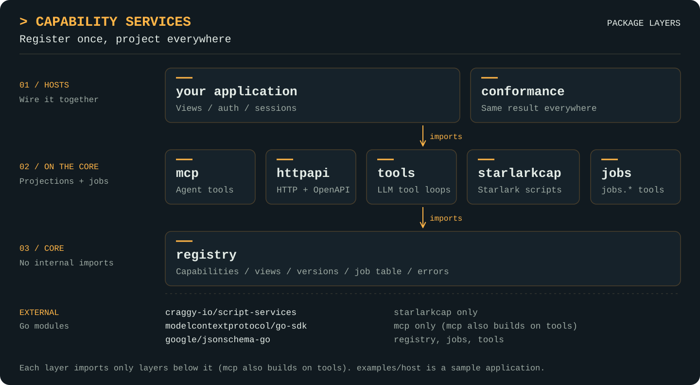

<picture>
  <source media="(prefers-color-scheme: dark)" srcset="docs/assets/craggy-wordmark-on-dark.svg">
  
</picture>

# Capability Services

One registry of capabilities, projected mechanically into every surface that
needs them: MCP tools for agents, an HTTP API with a generated OpenAPI document,
Starlark built-ins, and in-process LLM tool-calling loops. Register each capability
once. It can be added, replaced, versioned and superseded at runtime, and every
projection follows. Any call can run as a long-running job with stage progress,
heartbeat/liveness and cancellation.

The module is `github.com/craggy-io/capability-services`. It is domain-free: it
knows nothing about storage, classification, data or security tooling. Domain
libraries keep their own Go APIs; small `*cap` adapter packages beside them turn
those APIs into capabilities, and the host application decides who sees what.
The design is in [docs/design.md](docs/design.md).

## Features

- **One shape, every surface:** [register a typed Go function or a hand-written handler](docs/registry.md) once; MCP, HTTP, Starlark and [in-process tool loops](docs/projections.md#tools-in-process-tool-calling-loops) are mechanical translations of it.
- **Runtime change:** [add, replace, version and supersede](docs/registry.md#versions-and-supersession) capabilities while the program runs; listings, MCP tool lists and OpenAPI follow immediately.
- **Views as policy:** [a view is the registry filtered by name, tag or effect](docs/registry.md#views-as-policy). Filtering and enforcement are the same thing, and a nested call never gets wider access than the view it arrived on.
- **Jobs for every call:** [stage progress, heartbeats, stalled detection, cancellation, child jobs](docs/jobs.md) and the `jobs.*` capabilities, with an optional status journal that marks interrupted jobs `lost` after a restart.
- **Coded errors:** a closed set of codes, optional stable reasons, and one error envelope that [every projection](docs/projections.md#one-error-envelope) carries unchanged.
- **Capabilities defined in Starlark:** [load, check, hot-reload and test script files](docs/starlark.md) that define capabilities under a prefix, with content digests and recorded provenance. Superseding anything outside the prefix needs the host's explicit policy.
- **Conformance:** [one capability set, Go- and Starlark-defined, through every projection](docs/conformance.md), requiring identical results, codes, job behaviour and pagination.

## Package architecture

<p align="center">
  <a href="docs/assets/capability-services-architecture.svg">
    
  </a>
</p>

Read it top to bottom: each layer imports only the layers below it, and `mcp`
also builds on `tools`. `registry` imports none of the other packages.
`starlarkcap` is the only library package that imports
`github.com/craggy-io/script-services`, the generic Starlark runtime.

| Package | Responsibilities | Imports (in this module) | Guide |
| --- | --- | --- | --- |
| `registry` | The capability shape, typed `Func` registration, snapshots, versions, supersession, views/filters, middleware, jobs, readiness, groups, codes and reasons, `Descriptor`. Standard library plus `google/jsonschema-go` only. | none | [Registry](docs/registry.md) |
| `jobs` | `jobs.list`, `jobs.get`, `jobs.wait`, `jobs.cancel` as capabilities, their group and `WaitOut`. | registry | [Jobs](docs/jobs.md) |
| `registry/jobstoretest` | The `SharedJobs` conformance suite and an in-memory store. | registry | [Jobs](docs/jobs.md#shared-jobs-and-dispatch) |
| `longpoll` | An ordered change log as a capability that waits up to 25 s for the next change. | registry | [Long-poll](docs/longpoll.md) |
| `adapters/postgres` (own module) | `SharedJobs` in PostgreSQL (pgx). | registry | [Jobs](docs/jobs.md#shared-jobs-and-dispatch) |
| `tools` | LLM tool definitions and tool-call dispatch for in-process agent loops. No provider SDK. | registry | [Projections](docs/projections.md#tools-in-process-tool-calling-loops) |
| `mcp` | MCP projection on the official Go SDK: live tool sync, progress notifications, per-session `Caller`, `OnClose`. | registry, tools | [Projections](docs/projections.md#mcp) |
| `httpapi` | HTTP projection: `POST /v1/{ref}`, 202 + `Location`, `Prefer: wait=N`, job status/SSE/cancel, listings, health, OpenAPI 3.1. Standard library only. | registry | [Projections](docs/projections.md#http) |
| `starlarkcap` | Starlark in both directions: `Globals`, `Exec`, `Check`/`Analyze`, `Load`, `Watch`, `Test`. | registry | [Starlark](docs/starlark.md) |
| `conformance` | The suite every projection must pass, and the standard fake capability set. | all of the above | [Conformance](docs/conformance.md) |
| `examples/host` | A runnable host wiring fake domains and a Starlark file that supersedes a Go capability, behind HTTP or MCP stdio. | all but tools, conformance | [Run the example](#run-the-example) |

## Quick start

Register, choose views, project. This sketch uses the current API; the
[`registry` examples](registry/example_test.go) and the
[`starlarkcap` examples](starlarkcap/example_test.go) are the compiled, checked
versions of each step.

```go
type GetIn struct {
	ID string `json:"id" jsonschema:"artifact id"`
}

r := registry.New(registry.Use(audit), registry.Limit("analysis", 4))
defer r.Close() // cancels unfinished jobs and waits for them (JobDrainTimeout)

err := r.Add(
	registry.Func("storage.artifact.get", "Get an artifact's metadata",
		func(ctx context.Context, in GetIn) (Artifact, error) { /* call the domain API */ },
		registry.WithEffects(registry.ReadOnly|registry.Idempotent),
		registry.WithTags("agent")),
)
err = r.Add(jobs.Capabilities()...) // jobs.list/get/wait/cancel
err = r.AddGroup(jobs.Group())

// Runtime-defined capabilities from a bundle: ./caps/bundle.yaml declares
// {id: apk, kind: capability.script@1, path: apk.star}, so apk.star defines
// apk.*. Superseding a name outside the prefix needs the host's policy.
loaded, err := starlarkcap.Load(ctx, r, []bundle.Source{bundle.Dir("caps")},
	starlarkcap.LoadOptions{MaySupersede: registry.Match("jadx.*")})

agents := r.View(registry.And(
	registry.Or(registry.Tagged("agent"), registry.Match("jobs.*")),
	registry.Not(registry.Tagged("admin"))))
api := r.View(registry.All)

stop := mcp.Serve(mcpServer, agents)                             // MCP projection
http.Handle("/v1/", httpapi.Handler(api))                        // HTTP projection
defs := tools.Defs(agents)                                       // in-process loop, re-list each turn
globals := starlarkcap.Globals(registry.WithView(ctx, agents))   // Starlark built-ins
```

Here `mcp` is this module's `mcp` package (the example host imports it as
`regmcp` beside the SDK's `mcpsdk`). A view is the policy: the same registry gives
agents read-only tools and the HTTP API everything, without registering anything
twice.

## Run the example

From the module root (see [Development](#development) for the workspace setup):

```sh
go run ./examples/host                  # HTTP on :8080
go run ./examples/host -addr :9000      # another address
go run ./examples/host -mcp             # MCP over stdio
go run ./examples/host -scripts ./caps  # also load and hot-reload the bundle in ./caps
```

```sh
curl localhost:8080/v1/
curl -XPOST localhost:8080/v1/storage/artifact/get -d '{"id":"art-1"}'
curl -i -XPOST localhost:8080/v1/apk/decompile -d '{"artifact":"art-1"}'   # 202 + Location: /v1/jobs/<id>
curl localhost:8080/v1/jobs/<id>                                           # status, plus result on success
curl localhost:8080/v1/jobs/<id>/events                                    # Server-Sent Events
curl -XPOST -H 'Prefer: wait=5' localhost:8080/v1/apk/decompile -d '{"artifact":"art-1"}'
curl -i -XPOST localhost:8080/v1/jadx/decompile -d '{"id":"art-1"}'        # Craggy-Superseded-By: apk.decompile
curl localhost:8080/v1/openapi.json
curl localhost:8080/v1/health
```

At startup the host loads its built-in demo bundle
([examples/host/demo](examples/host/demo/bundle.yaml), embedded), whose `apk.star`
supersedes the Go-registered
`jadx.decompile`, with `LoadOptions.MaySupersede` admitting `jadx.*` and nothing
else. `jadx.decompile` drops out of `/v1/` listings and MCP tools but still
answers, with a `Craggy-Superseded-By` header, until `apk` is unloaded, when it
returns. With `-scripts DIR`, `DIR` is a bundle and **must contain a
`bundle.yaml`**: each capability file is a `capability.script@1` contribution
whose id is its prefix, `load()` resolves inside the bundle (read through an
`os.Root`; symbolic links are refused), a file may declare a `.go` types asset,
and edits are picked up within a second. The demo owns the `apk` prefix, so a
file with the id `apk` is refused with `conflict`. The host prints its
capability listing at startup: to stdout in HTTP mode, and to stderr in `-mcp`
mode, where stdout carries only the JSON-RPC stream. Logs go to stderr.

## Semantics worth knowing

- **Validation once.** Input is checked against the capability's JSON Schema in
  the registry before the handler runs, on every projection; the `invalid` message
  names each offending field and is the same text everywhere. Output is checked too
  in builds with the `craggy_debug` tag or with `registry.ValidateOutput(true)`.
- **Views are the policy.** A name outside the caller's view is `not_found`, even
  if it exists elsewhere. A handler's nested calls are clamped to the view its call
  arrived on, so a script capability cannot widen its caller's access.
- **Stage progress is not job progress.** `Update.Done/Total/Unit` describe one
  named stage; there is no overall percentage. MCP progress notifications use a
  monotonic sequence with the stage counters in the message.
- **Only the job runner completes a job**, after the full middleware chain returns
  and the result encodes (and validates, when enabled). Late progress never revives
  or completes a terminal job, and cancellation is never converted to success.
- **Jobs outlive requests.** A job keeps its caller and view but drops the
  request's cancellation; only `Job.Cancel` stops it. A job started from a handler
  is a child of that handler's job and is cancelled with it.
- **Close drains.** `Registry.Close` cancels unfinished jobs and waits for their
  runners, bounded by `JobDrainTimeout` (default 10s). From then on `Start` and
  `Invoke` fail with `unavailable` (reason `closed`), so a call racing `Close`
  either fails or is cancelled and waited for.
- **Jobs are not durable work.** The job table is in memory. `OpenJobJournal`
  keeps a status journal so interrupted jobs reappear as `lost`
  (`process_restarted`) after a restart; handlers are never resumed.
- **Errors carry codes** (`invalid`, `not_found`, `denied`, `conflict`,
  `unavailable`, `cancelled`, `internal`) and optionally a stable lower_snake_case
  reason (`no_capacity`, `backend_down`, `not_ready`, ...). Every projection maps
  them mechanically and carries the same envelope.
- **Script failures are `internal`.** A failure inside a script-defined capability
  is the script's fault, so it surfaces as `internal`; a nested capability's code
  stays visible in the message (`internal: apk.lock: apk.star:2:41: conflict: ...`).
- **Scripts supersede only what the host allows.** A capability file may
  supersede anything under its own prefix, and outside it only what
  `LoadOptions.MaySupersede` admits.
- **Capability files come from bundles.** A folder of capability files needs a
  `bundle.yaml` declaring each one; its contribution id is its prefix (no `.`),
  and nothing is discovered from file names. A prefix claims its whole name: a
  file `jadx` replaces every `jadx.*` capability, Go-registered ones included. One
  file owns one prefix: an install refuses (`conflict`) to replace capabilities
  another file installed.
- **`Func` panics** on programmer errors (nil function, underivable schema, such
  as recursive types; override those with `WithInput`/`WithOutput`).
  Registry-state errors (duplicate `name@version`, bad names, supersession cycles,
  examples that fail their schema) are returned by `Add`/`Replace`, which are
  all-or-nothing.

Start with the [documentation index](docs/README.md). For coding-agent
integration and repository development guidance, see [AGENTS.md](AGENTS.md).

## Development

Requires Go 1.27 or newer. Dependencies: `github.com/google/jsonschema-go`,
`github.com/modelcontextprotocol/go-sdk`, `go.starlark.net`,
`github.com/craggy-io/script-services` and `github.com/craggy-io/foundation-kit`
(bundles, and `archtest` for the import rules).

**Depends on a published script-services.** [go.mod](go.mod) requires
`github.com/craggy-io/script-services` like any other dependency, at its
first tagged release (`v0.1.0`). Both modules are private: consumers need
authenticated Git access and `GOPRIVATE` covering `github.com/craggy-io/*`.

```sh
go test ./...
go test -race ./...
go test -tags craggy_debug ./...   # output validated against every output schema
go vet ./...
go build ./...
```

Package examples (`example_test.go`) carry `// Output:` checks, so `go test`
verifies the code the guides quote. `go test ./...` includes the
[conformance suite](docs/conformance.md).
